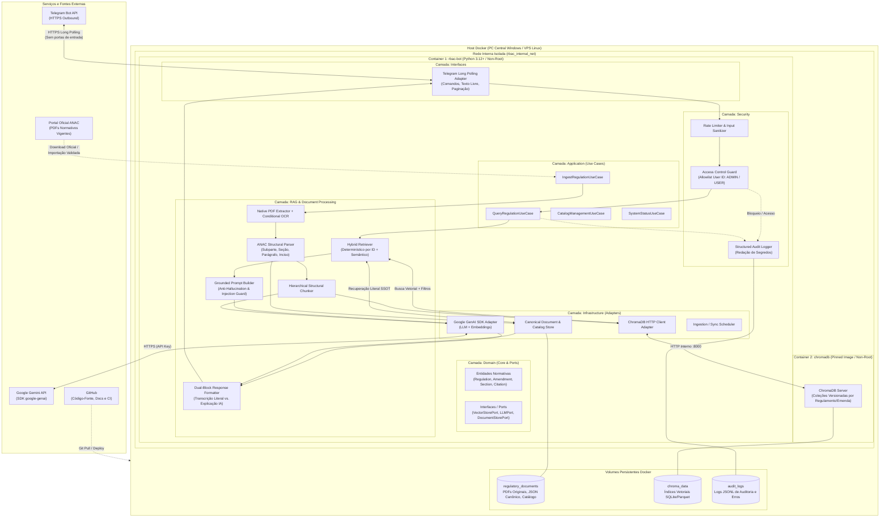
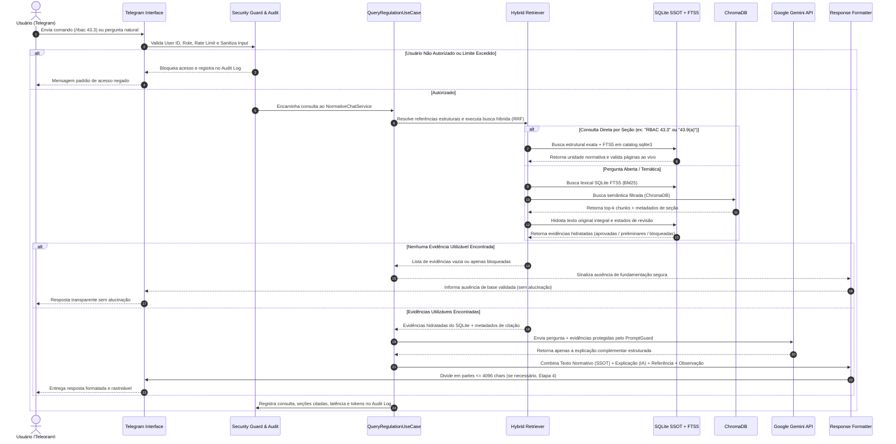

# Arquitetura do Sistema — RBAC AI Assistant

**Versão:** 1.0 (Baseline Arquitetural MVP)  
**Domínio:** Regulamentação Aeronáutica Brasileira — ANAC (*Regulamentos Brasileiros da Aviação Civil*)  
**Padrão Arquitetural:** Arquitetura Hexagonal (*Ports and Adapters*) com *src-layout*

---

## 1. Visão Geral

O **RBAC AI Assistant** é um assistente normativo especializado em Regulamentos Brasileiros da Aviação Civil (RBAC) da ANAC, inicialmente focado no **RBAC 43** (*Manutenção, Manutenção Preventiva, Reconstrução e Alteração*), operado via Telegram com **Long Polling** e hospedado em contêineres Docker.

### Princípios Arquiteturais

1. **Arquitetura Hexagonal (*Ports and Adapters*):** O núcleo de domínio (`domain/`) e casos de uso (`application/`) não possui dependências diretas de frameworks externos (Telegram, ChromaDB, PyMuPDF ou SDK do Gemini).
2. **Separação Estrita entre Fato Normativo e Interpretação IA:** O texto literal das normas é recuperado deterministicamente do **Armazenamento Canônico (SSOT)** em disco (`regulatory_documents`) e nunca é reescrito pelo LLM. O Google Gemini gera exclusivamente a explicação complementar fundamentada.
3. **RAG Jurídico-Normativo Híbrido:** Combina busca determinística prioritária por identificador de seção (ex.: `43.3`, `43.9(a)`) com busca semântica filtrada por emenda vigente no ChromaDB.
4. **Terminologia Sem Ambiguidade:** O termo `rbac` é reservado exclusivamente para *Regulamento Brasileiro da Aviação Civil*. O controle de acesso operacional do bot utiliza `access_control` e `operator_roles` (`ADMIN` / `USER`).
5. **Segurança Determinística (Python-First):** Autenticação por `Telegram User ID`, *rate limiting*, redação de segredos e auditoria em JSONL executam estritamente em Python, nunca delegados ao LLM.

---

## 2. Diagrama da Arquitetura



---

## 3. Responsabilidade das Camadas

| Camada / Módulo | Responsabilidade Arquitetural | Restrições de Dependência |
| :--- | :--- | :--- |
| **`config/`** | Carrega e valida `.env` + YAMLs (`settings.yaml`, `access_control.yaml`, `regulations_catalog.yaml`) via `pydantic-settings` e configura logs estruturados com redação. | Importado por `main.py` e `infrastructure`; sem regras normativas. |
| **`domain/`** | Entidades (`Regulation`, `Amendment`, `NormativeUnit`, `Citation`, `NormativeResponse`), exceções de negócio e *Ports* (contratos abstratos). | **Zero dependências externas.** Apenas biblioteca padrão Python. |
| **`application/`** | Casos de uso (`QueryRegulationUseCase`, `IngestRegulationUseCase`, `ListDocumentsUseCase`, `CheckSystemStatusUseCase`) e DTOs. | Depende exclusivamente de `domain/`. |
| **`security/`** | Controle de acesso determinístico por `Telegram User ID` (`ADMIN`/`USER`), *rate limiting*, sanitização contra *Prompt Injection*, redação de segredos e `AuditLogger` JSONL. | Depende de `domain/ports/audit_port.py` e `config/`. |
| **`rag/ingestion/`** | Extração nativa de PDF (`PyMuPDF`/`pdfplumber`) + OCR condicional, validação textual, parser hierárquico ANAC e chunking estrutural. | Depende de `domain/` e bibliotecas de parsing PDF. |
| **`rag/retrieval/`** | Resolução de referências (`43.3(a)(1)`), busca híbrida (SSOT + ChromaDB) e reconstrução de seções multi-chunk com isolamento de emendas. | Depende de `domain/ports/`. |
| **`rag/generation/`** | Prompts blindados (evidência única, não-reprodução, recusa transparente) e `ResponseFormatter` de saída dual. | Depende de `domain/`. |
| **`infrastructure/`** | Adaptadores concretos: ChromaDB HTTP Client, `google-genai` (LLM + Embeddings), armazenamento canônico atômico em disco e agendador. | Implementa `domain/ports/`. Único local onde SDKs externos são instanciados. |
| **`interfaces/telegram/`** | Bot Long Polling, middleware de segurança, handlers de comandos/texto livre e `MessageSplitter` (<= 4096 chars). | Depende de `application/` e `security/`. |
| **`main.py`** | *Composition Root* — monta injeção de dependências e gerencia ciclo de vida gracioso (`SIGINT`/`SIGTERM`). | Único módulo que acopla todas as camadas. |

---

## 4. Fluxo de Consultas e Contrato Visual de Resposta



### Estrutura Obrigatória de Saída

Toda resposta normativa separa rigorosamente transcrição literal (SSOT SQLite), explicação gerada por IA, referências rastreáveis e observações de governança (ver Seção 2 do [`README.md`](../../README.md#2-arquitetura-de-dados-sqlite-e-fontes-de-verdade)):

```text
=== TEXTO NORMATIVO (LITERAL VALIDADO — SQLite SSOT) ===
[Transcrição literal recuperada exclusivamente de original_text no SQLite em páginas aprovadas.]

=== EXPLICAÇÃO (GERADA POR IA) ===
[Interpretação técnica elaborada pelo Google Gemini estritamente baseada nas evidências acima.]

=== REFERÊNCIA ===
- ANAC RBAC 43 (Emenda XX | vigência: current) — Seção 43.3 — PDF p. [...] | Impressa: [...] — [Aprovado para transcrição literal]

=== OBSERVAÇÃO ===
- [Avisos de revisão preliminar, bloqueio OCR/reprovação, vigência ou degradação, quando aplicável.]
```

---

## 5. Estratégia Gemini, Telegram e Docker

### Google Gemini (`google-genai`)
- Utiliza exclusivamente o SDK oficial `google-genai==3.6.1`.
- Aplica **política única de modelos em runtime** via `.env` (`GEMINI_GENERATION_MODEL=gemini-4-hydrogen`, `GEMINI_EMBEDDING_MODEL=gemini-embedding-2`, `GEMINI_EMBEDDING_DIMENSIONS=768`, `GEMINI_ALLOW_PAID_MODELS=false`), com validação estrita em `AppSettings` e `GeminiClientAdapter` e **sem fallback silencioso** (ver ADR-08).
- Utiliza API Key dedicada da Gemini Developer API (Google AI Studio) separada da assinatura pessoal Google AI Pro usada no Antigravity para desenvolvimento; ausência de cobrança depende também de manter o projeto Google sem Cloud Billing vinculado.
- Em caso de indisponibilidade da API Gemini, o sistema aplica *graceful degradation*, entregando `TEXTO NORMATIVO` e `REFERÊNCIA` recuperados localmente do SQLite.

### Telegram (Long Polling)
- Comunicação exclusivamente de saída (*outbound HTTPS*), sem abertura de portas ou webhooks.
- Comandos planejados: `/start`, `/help`, `/status`, `/rbac <seção>`, `/buscar <termo>`, `/explicar <seção>`, `/documentos`, `/versao`, perguntas em texto livre e comando administrativo opcional `/admin_ingest` (restrito a `ADMIN`).
- Paginação inteligente (`MessageSplitter`) respeitando o limite de 4.096 caracteres sem resumir ou truncar o texto normativo.

### Contêineres Docker e Volumes
- **Container 1 (`rbac-bot`):** `python:3.12-slim-bookworm`, build multi-stage com `uv`, usuário non-root (`appuser`, UID/GID `10001`), zero portas publicadas no host, limites sugeridos `1.0 CPU / 1024M RAM`.
- **Container 2 (`chromadb`):** `docker/chromadb.Dockerfile` mínimo baseado na imagem oficial `chromadb/chroma:1.5.9` (UID/GID `10001` non-root, preservando `ENTRYPOINT` e `CMD` oficiais), isolado exclusivamente na rede interna `rbac_internal_net` (sem `ports:` no host), limites sugeridos `1.0 CPU / 1536M RAM`.
- **Volumes nomeados:** `regulatory_documents` (`/app/data/documents`), `chroma_data` (`/data`) e `audit_logs` (`/app/logs`).
- **Resiliência:** `restart: unless-stopped` e healthcheck no endpoint oficial `GET /api/v2/heartbeat` do ChromaDB 1.5.9.

---

## 6. Plano de Etapas

| Etapa | Escopo Principal | Critério de Aceite Resumido |
| :--- | :--- | :--- |
| **Etapa 0** | Arquitetura, ADRs, `src-layout`, `.gitignore`, `.dockerignore` e templates | Estrutura versionada, documentação completa e zero credenciais/PDFs no Git |
| **Etapa 1** | `pyproject.toml`, `settings.py`, fundação hexagonal, `Dockerfile` e `docker-compose.yml` | `rbac-bot` e `chromadb` saudáveis, non-root e comunicando pela rede interna |
| **Etapa 2** | Protocolo ANAC RBAC 43, extração nativa + OCR condicional, parser ANAC e SSOT | 100% das seções do RBAC 43 extraídas com dupla paginação e ingestão idempotente |
| **Etapa 3** | Adaptador `google-genai`, ChromaDB, RAG híbrido e `ResponseFormatter` dual | Busca determinística exata + explicação fundamentada + recusa sem alucinação |
| **Etapa 4** | Bot Telegram (Long Polling), controle de acesso `ADMIN`/`USER`, comandos e splitter | Allowlist rigorosa, 8 comandos + texto livre e paginação fiel >4096 chars |
| **Etapa 5** | Suíte completa `pytest` (`unit`, `integration`, `evals`), backups e operação contínua | Dataset áureo aprovado caractere a caractere e backup/restore validado |
