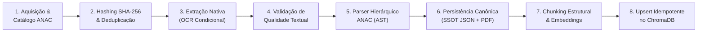

# Runbook de Verificação ANAC e Ingestão Documental

Este runbook define o procedimento operacional obrigatório para homologar e ingerir regulamentos da ANAC (iniciando pelo **RBAC 43**) garantindo rastreabilidade jurídica, fidelidade literal e idempotência.

---

## 1. Protocolo Mandatório Pré-Ingestão (Governança ANAC)

> **Regra Inviolável:** Nunca presumir que uma emenda histórica permanece vigente. Todo regulamento deve ser conferido diretamente no portal oficial da ANAC antes da ingestão.

1. **Consultar o Portal Oficial da ANAC:** Acessar a página oficial de legislação aeronáutica da ANAC para o regulamento desejado (ex.: RBAC 43).
2. **Confirmar Emenda e Resolução:** Identificar o número exato da **Emenda vigente** e a **Resolução ANAC** que a aprovou.
3. **Validar Status de Vigência:** Confirmar se a situação jurídica é `VIGENTE`, `REVOGADO` ou `ALTERADO PARCIALMENTE`, registrando `publication_date` e `effective_date` (ISO-8601).
4. **Registrar URL Oficial e Timestamp:** Anotar a URL exata de download do PDF na ANAC (`official_url`) e a data/hora da consulta (`consulted_at`).
5. **Calcular Integridade (`SHA-256`):** Baixar o PDF oficial para o diretório local de entrada (`data/raw_pdfs/`, fora do Git) e calcular o hash SHA-256 (utilizando `scripts/verify_anac_document.py` na Etapa 2).
6. **Inspecionar Paginação Dupla:** Abrir o PDF e verificar o deslocamento entre a **página física do PDF** (`pdf_page_number`) e a **página impressa oficial da ANAC** (`printed_page_number`, ex.: rodapé `Página X de Y`).
7. **Atualizar `config/regulations_catalog.yaml`:** Registrar todos os metadados verificados e definir `is_current_amendment: true` somente para a emenda vigente.

---

## 2. Pipeline de Ingestão Idempotente (8 Etapas)

### Garantias de Idempotência e Versionamento
- **Mesmo `document_id` + mesmo `SHA-256` já validado:** execução encerra sem duplicar registros nem gerar custos desnecessários de embeddings.
- **Nova emenda para o mesmo RBAC:** cria versão isolada (`rbac_43_emd_XX`), preservando emendas anteriores para consultas históricas sem sobrescrita silenciosa.
- **IDs determinísticos no ChromaDB:** `{regulation_number}_{amendment_number}_{section_number}_{chunk_index}`.

---

## 3. Verificação Pós-Ingestão Obrigatória

Antes de promover o documento ao status `validated`:

1. Confirmar que **100% das seções** listadas no sumário oficial existem no `Canonical Store` (`data/canonical_store/`).
2. Verificar se alguma página precisou de `ocr_fallback`; caso positivo, executar conferência manual caractere a caractere antes de marcar como `validated`.
3. Conferir por amostragem a correspondência entre `pdf_page_number` e `printed_page_number`.
4. Reexecutar o comando de ingestão e comprovar **zero duplicações** no ChromaDB.
5. Executar a suíte de fidelidade normativa (`uv run pytest tests/evals/test_normative_fidelity.py`).
